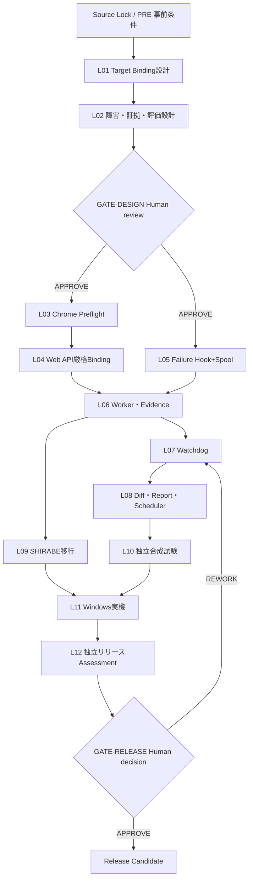

# 全体開発プロセス

## 各工程で繰り返すExecution契約
1. 先行チケット、source hash、変更可能ファイルを点検。
2. **EXECUTIONチャット**にTicket本文と必須添付、前工程Evidenceを渡す。
3. 変更は新Candidate Workspaceで実施。SHIRABE正本/Stableへ直接上書きしない。
4. テストを実行し、コマンド/環境/Exit Code、PASS/FAIL/BLOCKED/NOT_RUNを記録。
5. `RESULT.json`+`REPORT.md`+差分+証拠を固定しManifest/SHA-256を作る。
6. 次工程は参照元hashを確認後、独立Assessmentへ渡す。

## ステージ
| Stage | Ticket | 主要なExit Evidence | 権限 |
|---|---|---|---|
| 設計固定 | L01-L02 | Target/Browse Epoch/障害/Bundle/差分の詳細設計、設計評価 | 人間のGATE-DESIGN |
| Target確立 | L03-L04 | 1枚Tab Binding / no fallback / no double send試験 | Candidateのみ |
| 診断成立 | L05-L06 | S0永続化・独立Worker・秘匿Bundle | Candidateのみ |
| 故障継続性 | L07 | SHIRABE強制終了・worker timeoutの部分証拠 | Candidateのみ |
| 監視と評価 | L08 | Baseline差分/Report/Windows登録スクリプト | 登録は人の操作 |
| SHIRABE連携 | L09 | Source Lock付き利用側diff・不変のWORK Authority | SHIRABE個別Gate |
| 品質評価 | L10-L12 | 合成・Windows・リリース独立Assessment | 人間のGATE-RELEASE |

L09とL07-L08はL06後に並列進行可能。L10はL08後、L11はL09+L10後とする。SHIRABE最新ソースが得られなければL09以降のみBLOCKEDとし、CDPD単独の合成検証は継続可能。

## Stop conditions
- Target ID/epoch検証失敗時は他タブを探さず処理中止。
- ユーザーの承認なしにライブChatGPTへ自動送信、Schedulerの本番登録、Stable昇格をしない。
- `PARTIAL`を`COMPLETE`に補正しない。CDPDのCOMPLETEを業務成功に変換しない。

## 2026-10-18 Human Gate 1決裁の記録

[正式Human Decision](../gates/GATE-DESIGN_APPROVAL_20261018.json)によりGATE-DESIGNをAPPROVEDとして記録した。現在状態は[CURRENT_STATE](../CURRENT_STATE.json)、N-01/N-02のL06対応は[Issue台帳](../issues/00_ISSUES.md)、可用性制約の採用は[ADR-001](adr/ADR-001_Cumulative_Loss_Availability.md)を参照する。本追記は元DAGや製品Authorityを変更しない。
