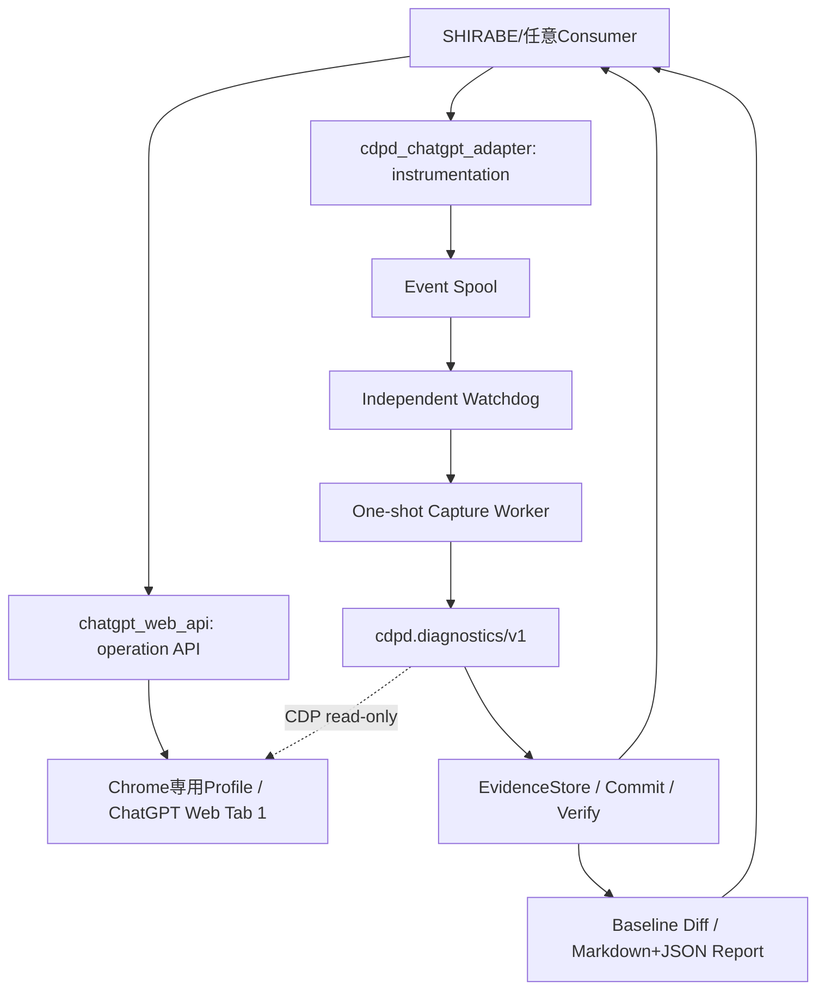

# 最小構造・責務・公開契約



## 既存v0.2.1から再利用するAPI
- Web操作 `chatgpt_web_api.api.create_facade(cdp_url=..., session=...)`、`chatgpt-web.facade/v2`。
- 診断 `cdpd.DiagnosticEvent`、`cdpd.TargetBinding`、`cdpd.CaptureRequest`、`DiagnosticService.record/capture`、`verify_bundle()`、`cdpd.diagnostics/v1`。
- 任意InstrumentedFacadeは`operation_id`引数が追加されるため、素のFacade v2と同じ署名ではない。`validate_facade_contract()`は元providerに適用。
- EvidenceStoreは`TRIGGER.json/RESULT.json/EVENTS.json/STRUCTURE.json?`、`MANIFEST.json`、`COMMIT.json`の既存方式を継承する。

## 変更対象となる内部実装
- strict binderと`Preflight→TargetBinding`の結線。
- in-memory Event Queueに追加するdurable metadata spool。
- independent capture worker + heartbeat watchdog（外部公開RESTは実装しない）。
- 機能契約に限定したBaseline diff・レポート・Windows Task Schedulerの任意登録。

## Binding最小契約（例）
```json
{
  "endpoint": "http://127.0.0.1:9222",
  "target_id": "<verified-cdp-target-id>",
  "expected_origin": "https://chatgpt.com",
  "expected_browser_id": "<browser-epoch-fingerprint>"
}
```
`expected_browser_id`はv0.2.1既存フィールド名であり、実際の値の導出アルゴリズムをL01で確定する。プロセスIDだけでは再起動識別として不十分。Target IDとbrowser epochを一組で比較する。

## Failure Event
```json
{
  "schema":"cdpd.event/v1",
  "producer_id":"chatgpt-web",
  "producer_instance_id":"<instance-id>",
  "operation_id":"<caller-owned-id>",
  "kind":"OBSERVATION_FAILED",
  "failure_code":"TIMEOUT",
  "correlation":{"run_id":"<SHIRABE-caller-ID>"}
}
```

## 障害レポートのMeaning
`capture_status` = Evidence収集範囲の成否（`COMPLETE/PARTIAL/REJECTED`）、`assessment_status` = 原因分析の評価（v0.2.1は`NOT_PERFORMED`）、`WebFacadePromptResult.completed` = Web応答状態、`SHIRABE.WORK` = 別Authority。4者を混同しない。

## Fail closed
診断のためにCDPDがUIへ文字入力、クリック、Tab移動、Reload、送信、自動再送、Stable更新をしない。Chrome単一タブは運用制約として検証し、「単一タブだからtargetが同じ」と推定しない。
